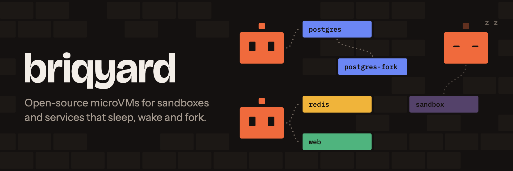
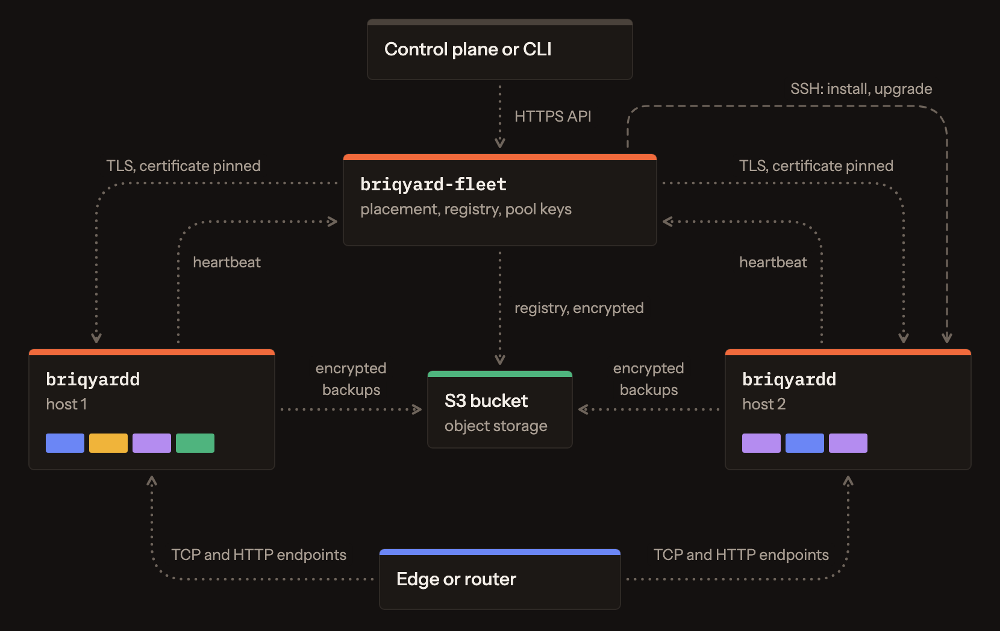
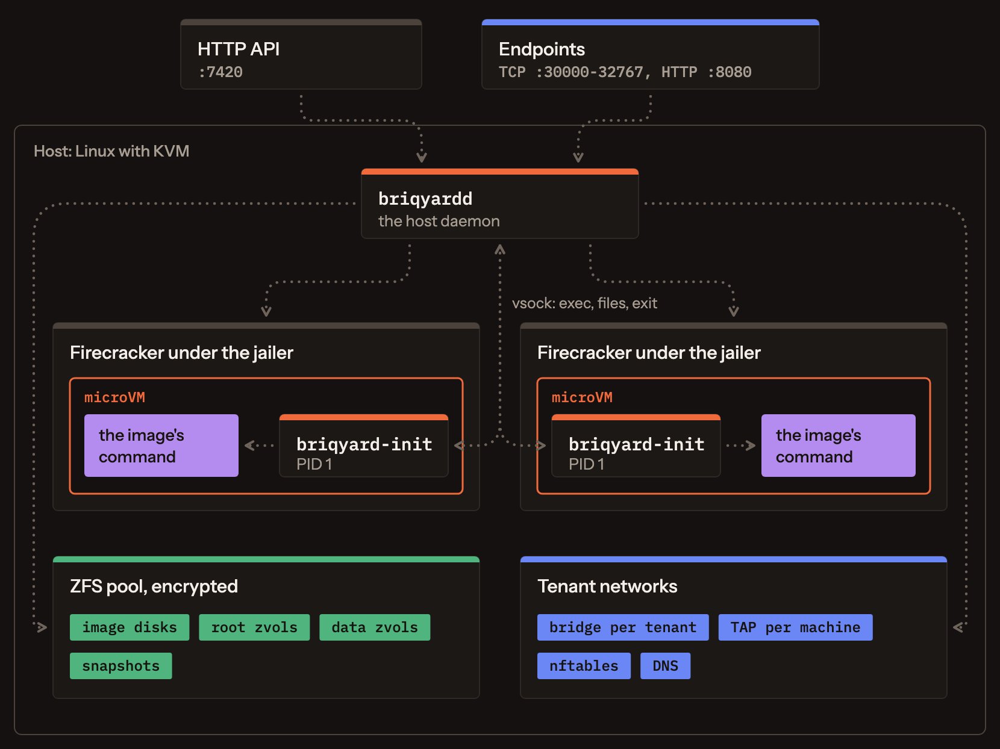

# 🧱 briqyard

**Open-source microVMs for sandboxes and services that sleep, wake and fork.**

briqyard runs any OCI image in a Firecracker microVM on servers you own. Each machine gets a durable disk, a private network shared with its tenant, and a sleep window: it stops when unused and wakes on the next connection or command. It is written in Rust and licensed AGPL-3.0.

**briqyard powers [briq.cloud](https://briq.cloud).** For managed sandboxes and microVMs for your agents, without running servers, [start on briq.cloud](https://briq.cloud).

> **Status:** under active development toward a stable 1.0 API.

## Key features

| Feature | What it does |
|---|---|
| 📦 **Any image** | Pulled from a registry, unpacked once into an image disk, cloned per machine in milliseconds |
| 💾 **Durable disks** | A root disk and an optional data volume per machine, ZFS zvols on the host's NVMe. `fsync` reaches the disk; a volume grows, never shrinks |
| 🔀 **Snapshots and forks** | Copy-on-write: a snapshot of the disks (and of the memory, if asked), a restore in place, a fork as a new machine with its data |
| 😴 **Sleep and wake** | Stopped after its sleep window, woken by a connection or a command. With a memory snapshot, the processes carry on where they were |
| 🌐 **A network per tenant** | A bridge, a subnet and DNS per tenant: machines reach each other by name, nothing else reaches them. No machine has a public address |
| 🚦 **Egress control** | Per machine: open, none, or only through another machine (the tenant's gateway, which can hold secrets or filter traffic). Blocked ports, a connection rate and a bandwidth cap |
| 🔌 **Endpoints** | A TCP port or an HTTP name on the host that reaches a machine's port, and wakes it |
| 💻 **Exec, files, logs** | Commands with stdin, exit code and timeout; interactive sessions with a terminal over a WebSocket; files in and out; the console as logs, followed live |
| 🩺 **Probes and restarts** | Startup, readiness and liveness checks (exec, TCP, HTTP); a restart policy with backoff |
| ⚖️ **Limits and quotas** | vCPUs, memory, disk throughput and IOPS per machine; machines, memory, vCPUs and disk per tenant |
| 🗄️ **Backups** | ZFS streams to S3 or a directory: incremental, encrypted, on a schedule, restored on any host |
| 🔐 **Encrypted at rest** | Every host's pool is encrypted (AES-256-GCM) with a key the fleet holds; no swap |
| 🛡️ **Isolation** | KVM per machine; Firecracker under its jailer, with a chroot, a uid, a pid namespace, a cgroup and seccomp filters each |
| 🖥️ **Several hosts** | One API across hosts: placement by region and free memory, a server you bring added and installed over SSH, upgraded in place while its machines run. Capacity signals per region for a scaler of yours |
| 📈 **Observable** | An event log with a watch, a version per machine (`If-Match`), Prometheus metrics, host conditions, usage per machine; Prometheus and Grafana beside the fleet, with dashboards and alerts |

## Architecture

Across hosts. The fleet speaks the same API as each host, so a client talks to either the same way. A tenant lives on one host, so its network needs no overlay.



On one host. Each machine is a Firecracker process, with its disks on the pool and a TAP device on its tenant's bridge.



What a create does:

1. The host pulls the image once and unpacks it into an image disk.
2. It clones that disk as the machine's root disk, and makes the data volume.
3. It writes a config drive with the env, the files and the secrets.
4. It starts Firecracker under the jailer.
5. Inside, `briqyard-init` starts the image's command and reports when it exits.

How each part works: [docs/ARCHITECTURE.md](docs/ARCHITECTURE.md). Every decision and its reasons: [docs/adr/](docs/adr/).

## Concepts

What you work with, and its closest Kubernetes counterpart.

| briqyard | What it is | Kubernetes |
|---|---|---|
| **Machine** | One microVM running one OCI image: its own kernel, one main process, exec for the rest | Pod |
| **Image** | An OCI image, unpacked once per digest into a disk that machines clone | Container image |
| **Volume** | A machine's data disk, kept across stops, snapshots and forks | PersistentVolume and claim |
| **Snapshot** | A named copy of a machine's disks, and of its memory if asked; a machine goes back to it in place | VolumeSnapshot |
| **Fork** | A new machine made from another's disks, at once | none |
| **Tenant** | A group of machines with its own network, DNS and quotas, isolated from the others | Namespace |
| **Endpoint** | A TCP port or an HTTP name on the host that reaches a machine's port and wakes it | Service (NodePort), Ingress |
| **Egress policy** | Where a machine's traffic may go: open, none, or through another machine | NetworkPolicy |
| **Gateway** | A machine of the tenant that the machines set to `via: gateway` send their traffic through, to filter it or add secrets | Egress gateway |
| **Probes** | Startup, readiness and liveness checks by exec, TCP or HTTP | startupProbe, readinessProbe, livenessProbe |
| **Restart policy** | What happens when the main process exits: `no`, `on-failure` or `always`, with backoff | restartPolicy, CrashLoopBackOff |
| **Sleep window** | How long a machine stays up unused before it stops; the next use wakes it | none |
| **Backup** | A machine's disks in an object store, restored as a new machine on any host | Velero, outside the core |
| **Host** | A server running `briqyardd` and its machines | Node |
| **Fleet** | One API over many hosts: places each tenant on a host, forwards the calls | Control plane and scheduler |
| **Region** | Where a host is; a tenant's machines stay in one | Topology zone |
| **Labels** | Metadata on a machine, to select machines by | Labels and selectors |
| **Events** | A log of what happened on a host, with a watch from a cursor | Events, watch |

Not there yet: replicas and groups of identical machines, rolling updates, load balancing between machines, and a tenant spanning several hosts. The full comparison: [docs/KUBERNETES-MAP.md](docs/KUBERNETES-MAP.md).

## Binaries

| Binary | Runs on | What it does |
|---|---|---|
| `briqyardd` | Every host, as root | Runs the host's machines: their Firecracker processes, disks, networks, endpoints, sleep and backups. Serves the API |
| `briqyard-init` | Inside every machine, as PID 1 | Starts the image's command and reports when it exits. Answers exec, files and terminal sessions over vsock |
| `briqyard-fleet` | One server that reaches every host | Serves the same API for the whole fleet: picks a host for each tenant and forwards each call there. Keeps the list of hosts and their disk keys. Installs and upgrades hosts over SSH. Says what ran out when a create finds no room |
| `briqyard` | Anywhere | The CLI, for one host or a fleet |

`hack/bootstrap-host.sh` turns a fresh Ubuntu server into a host; the fleet runs it to install a host and again to upgrade it. Two libraries are shared: `briqyard-api` (the API's types, and the protocol between a host and its machines' init) and `briqyard-objstore` (S3 or a directory, for backups and the fleet's registry).

## Install

You need a Linux server, x86_64 or arm64, with KVM (`ls /dev/kvm`), Ubuntu Server 26.04, and a disk or free space for the pool. Releases carry the binaries for both architectures.

Install a host, as root on the server:

```bash
curl -fsSLO https://raw.githubusercontent.com/briq-cloud/briqyard/main/hack/bootstrap-host.sh
BRIQYARD_RELEASE=https://github.com/briq-cloud/briqyard/releases/download/v0.1.3 \
BRIQYARD_POOL_DEVICE=/dev/nvme1n1 BRIQYARD_TOKEN=$(openssl rand -hex 24) \
ALLOWED_CLIENTS=203.0.113.0/24 bash bootstrap-host.sh
```

Run a machine, from a computer in `ALLOWED_CLIENTS` (the script prints the API certificate's fingerprint):

```bash
export BRIQYARD_URL=https://<host>:7420 BRIQYARD_TOKEN=<token> BRIQYARD_TLS_FINGERPRINT=<fingerprint>
briqyard machine run --image postgres:16-alpine -e POSTGRES_PASSWORD=secret \
  --volume 10G:/var/lib/postgresql/data -p 5432 --sleep 30m
briqyard machine exec <id> -- psql -U postgres -c 'select 1'
briqyard endpoint add <id> 5432     # a port on the host; a connection wakes the machine
briqyard machine fork <id>          # a copy of its disks, as a new machine
```

Add hosts to a fleet:

```bash
briqyard host add <ssh address> --address <API address> --region <region>
briqyard host upgrade <id> --release <version or URL>   # its machines keep running
```

Step by step, with every option, a fleet and a Mac for development: [docs/INSTALL.md](docs/INSTALL.md).
TLS, public names and access control come from a proxy in front: [docs/OPERATIONS.md](docs/OPERATIONS.md#a-proxy-in-front).

## Tests

`cargo test` runs the unit tests. `hack/e2e.sh` checks a host end to end (about 220 checks); `hack/fleet-smoke.sh`, `hack/fleet-two-hosts.sh` and `hack/fleet-restore.sh` check a fleet; `hack/stress.py` runs many tenants at once and checks the host's invariants. See [docs/DEVELOPMENT.md](docs/DEVELOPMENT.md).

## Open-source software it builds on

| On the host | Use |
|---|---|
| [Firecracker](https://firecracker-microvm.github.io/) and its jailer | The microVMs (v1.17, pinned by digest) |
| Linux KVM | Hardware virtualization |
| [OpenZFS](https://openzfs.org/) | Disks, clones, snapshots, encryption, and send and receive for backups |
| nftables, Linux bridges and TAP devices | Tenant networks, egress rules, the host's firewall |
| ext4 | The guests' filesystems |
| Ubuntu Server 26.04, systemd | The host OS and its services |
| [Zot](https://zotregistry.dev/) (optional) | A pull-through registry mirror per region |

| Rust crates | Use |
|---|---|
| [axum](https://github.com/tokio-rs/axum), [hyper](https://hyper.rs/) | The HTTP API and the fleet's forwarding |
| [rustls](https://github.com/rustls/rustls), [rcgen](https://github.com/rustls/rcgen) | TLS for the API and its self-signed certificate |
| [oci-client](https://github.com/oras-project/rust-oci-client) | Pulling images from registries |
| [object_store](https://github.com/apache/arrow-rs-object-store) | S3 and directory storage for backups |
| [hickory-proto](https://github.com/hickory-dns/hickory-dns), [httparse](https://github.com/seanmonstar/httparse) | Parsing the DNS and HTTP that guests and clients send |
| [age](https://github.com/str4d/rage) | Encrypting the fleet's registry backup |
| [rtnetlink](https://github.com/rust-netlink/rtnetlink), [tokio-vsock](https://github.com/rust-vsock/tokio-vsock) | In the init: the guest's network interface through netlink, and its end of the vsock channel |

## License

AGPL-3.0, see [LICENSE](LICENSE). Contributions need a signed CLA, see [CONTRIBUTING.md](CONTRIBUTING.md).
