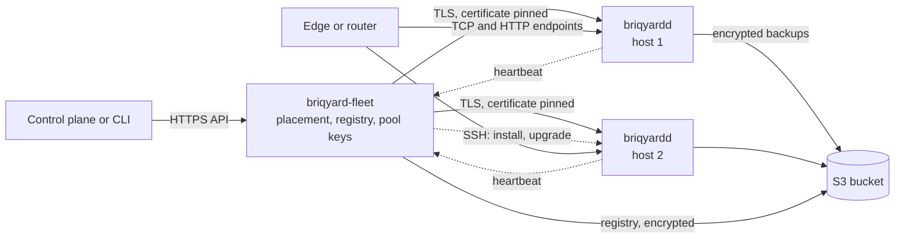
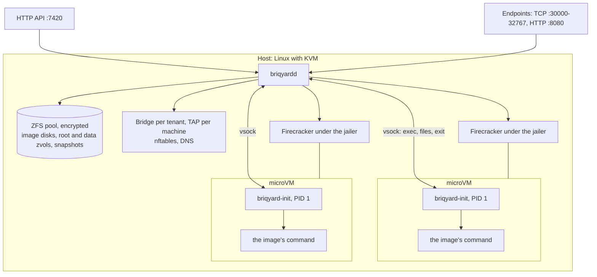

# briqyard

**Open-source microVMs for sandboxes and services that sleep, wake and fork.**

briqyard runs any OCI image in a Firecracker microVM on servers you own. Each machine gets a durable disk, a private network shared with its tenant, and a sleep window: it stops when unused and wakes on the next connection or command. It is written in Rust, licensed AGPL-3.0, and is the runtime under [briq](https://briq.cloud).

> Status: v0. The API can still change.

## Key features

| | |
|---|---|
| **Any image** | Pulled from a registry, unpacked once into an image disk, cloned per machine in milliseconds |
| **Durable disks** | A root disk and an optional data volume per machine, ZFS zvols on the host's NVMe; `fsync` reaches the disk; a volume grows, never shrinks |
| **Snapshots and forks** | Copy-on-write: a snapshot of the disks (and of the memory, if asked), a restore in place, a fork as a new machine with its data |
| **Sleep and wake** | Stopped after its sleep window, woken by a connection or a command; with a memory snapshot, the processes carry on where they were |
| **A network per tenant** | A bridge, a subnet and DNS per tenant: machines reach each other by name, nothing else reaches them; no machine has a public address |
| **Egress control** | Per machine: open, none, or only through another machine (the tenant's gateway, which can hold secrets or filter traffic); blocked ports, a connection rate and a bandwidth cap |
| **Endpoints** | A TCP port or an HTTP name on the host that reaches a machine's port, and wakes it |
| **Exec, files, logs** | Commands with stdin, exit code and timeout; interactive sessions with a terminal over a WebSocket; files in and out; the console as logs, followed live |
| **Probes and restarts** | Startup, readiness and liveness checks (exec, TCP, HTTP); a restart policy with backoff |
| **Limits and quotas** | vCPUs, memory, disk throughput and IOPS per machine; machines, memory, vCPUs and disk per tenant |
| **Backups** | ZFS streams to S3 or a directory: incremental, encrypted, on a schedule, restored on any host |
| **Encrypted at rest** | Every host's pool is encrypted (AES-256-GCM) with a key the fleet holds; no swap |
| **Isolation** | KVM per machine; Firecracker under its jailer, with a chroot, a uid, a pid namespace, a cgroup and seccomp filters each |
| **Several servers** | One API across hosts: placement by region and free memory, hosts added over SSH or ordered from a provider's API (with an autoscaler), upgraded in place while their machines run |
| **Observable** | An event log with a watch, a version per machine (`If-Match`), Prometheus metrics, host conditions, usage per machine |

## Components

| Component | Runs | Role |
|---|---|---|
| `briqyardd` | on every server, as root | The host daemon: the machines of that server. HTTP API, Firecracker processes, ZFS disks, tenant networks, nftables and DNS, endpoints, sleep, backups |
| `briqyard-init` | inside every microVM, as PID 1 | A static binary: mounts the disks, starts the image's command, reports its exit, serves exec, files and sessions over vsock |
| `briqyard-fleet` | once per installation | The same API across hosts: places tenants, forwards every call, keeps the hosts' registry and pool keys, orders and releases servers through provisioners (Hetzner Robot, Scaleway, OVH; dry run by default), installs and upgrades hosts over SSH |
| `briqyard` | anywhere | The CLI, for a daemon or a fleet |
| `briqyard-api` | library | The API's types and the host–guest protocol, shared by the four above |
| `briqyard-objstore` | library | Object storage (S3 or a directory) for backups and the fleet's registry |
| `hack/bootstrap-host.sh` | on a new server | Turns a fresh Ubuntu server into a host. The fleet ships it and runs it, and runs it again to upgrade |

## Architecture

Across servers. The fleet speaks the daemon's API, so a client talks to either the same way. A tenant lives on one host, so its network needs no overlay.



On one server. Each machine is a Firecracker process with its disks on the pool and a TAP device on its tenant's bridge.



A create: the daemon resolves the image, unpacks it once into an image disk, clones that as the machine's root disk, makes the data volume, writes a config drive (env, files, secrets) and starts Firecracker under the jailer. The init boots the image's command and reports when it exits. How each part works: [docs/ARCHITECTURE.md](docs/ARCHITECTURE.md). Every decision and its reasons: [docs/adr/](docs/adr/).

## Open-source software it builds on

| On the host | Use |
|---|---|
| [Firecracker](https://firecracker-microvm.github.io/) and its jailer | The microVMs (v1.17, pinned by digest) |
| Linux KVM | Hardware virtualization |
| [OpenZFS](https://openzfs.org/) | Disks, clones, snapshots, encryption, and send and receive for backups |
| nftables, Linux bridges and TAP devices | Tenant networks, egress rules, the host's firewall |
| ext4 | The guests' filesystems |
| Ubuntu Server 26.04, systemd | The host OS and its services |
| [Zot](https://zotregistry.dev/) (optional) | A pull-through registry mirror per region |

| Rust crates | Use |
|---|---|
| tokio, axum, hyper, reqwest, tokio-tungstenite | Async runtime, HTTP server and client, WebSockets |
| rustls, rcgen, ring, sha2 | TLS for the API and its certificate, the backup records' seal, digests |
| oci-client, tar, flate2, zstd | Pulling and unpacking images |
| object_store (Apache Arrow) | S3 and directory storage |
| hickory-proto, httparse | Parsing the DNS and HTTP that guests and clients send |
| age | Encrypting the fleet's registry backup |
| nix, rustix, rtnetlink, tokio-vsock | System calls, netlink, vsock |
| clap, serde | The CLI, the configuration and the API's JSON |

## Install

You need an x86_64 or arm64 Linux server with KVM (`ls /dev/kvm` lists it), Ubuntu Server 26.04, and free disk space for the pool. Each release carries the binaries for both architectures and their checksums (`SHA256SUMS-x86_64`, `SHA256SUMS-aarch64`).

**One host.** As root on the server:

```bash
curl -fsSLO https://raw.githubusercontent.com/briq-cloud/briqyard/main/hack/bootstrap-host.sh
BRIQYARD_RELEASE=https://github.com/briq-cloud/briqyard/releases/download/v0.1.0 \
BRIQYARD_POOL_DEVICE=/dev/nvme1n1 \
BRIQYARD_TOKEN=$(openssl rand -hex 24) \
ALLOWED_CLIENTS=203.0.113.0/24 \
bash bootstrap-host.sh
```

The script:
- installs ZFS and nftables;
- makes the encrypted pool on the device (on a file without `BRIQYARD_POOL_DEVICE`);
- downloads Firecracker, the jailer and a guest kernel, and checks their digests;
- installs the binaries, checked against the release's checksums;
- writes `/etc/briqyard/config.yaml` and starts `briqyardd`.

Without a fleet, the pool's key is `/etc/briqyard/pool.key`: keep a copy off the host. `ALLOWED_CLIENTS` lists the networks that may reach the API and the endpoints (`PRIVATE_ADDRESS` puts them on a private network instead); without either, they listen on loopback only, in plain HTTP. Off loopback the API serves TLS with a certificate of its own, whose fingerprint the script prints. Then, from a machine in `ALLOWED_CLIENTS`:

```bash
export BRIQYARD_URL=https://<host>:7420 BRIQYARD_TOKEN=<token> BRIQYARD_TLS_FINGERPRINT=<fingerprint>
briqyard status
briqyard machine run --image postgres:16-alpine -e POSTGRES_PASSWORD=secret \
  --volume 10G:/var/lib/postgresql/data -p 5432 --sleep 30m
briqyard machine exec <id> -- psql -U postgres -c 'select 1'
briqyard endpoint add <id> 5432     # a port on the host; a connection wakes the machine
briqyard machine fork <id>          # a copy of its disks, as a new machine
```

**Several hosts.** Run `briqyard-fleet` on one server, then add each server by its SSH address. The fleet runs the same script over SSH, gives the host its pool key, and pins its SSH key and API certificate. The host turns `ready` at its first heartbeat.

```bash
briqyard host add <ssh address> --address <API address> --region <region>
briqyard host ls
briqyard host upgrade <id> --release <version or URL>   # its machines keep running
```

Every option, the private network, backups, upgrades and a first server step by step: [docs/OPERATIONS.md](docs/OPERATIONS.md).

**On a Mac.** Apple silicon (M3 or later, macOS 15 or later) runs a host in a Lima VM with nested virtualization, along with the test suites: [docs/DEVELOPMENT.md](docs/DEVELOPMENT.md).

## Tests

`cargo test` runs the unit tests. `hack/e2e.sh` checks a host end to end (about 220 checks); `hack/fleet-smoke.sh`, `hack/fleet-two-hosts.sh` and `hack/fleet-restore.sh` check a fleet; `hack/stress.py` runs many tenants at once and checks the host's invariants. See [docs/DEVELOPMENT.md](docs/DEVELOPMENT.md).

## License

AGPL-3.0, see [LICENSE](LICENSE). Contributions need a signed CLA, see [CONTRIBUTING.md](CONTRIBUTING.md).
