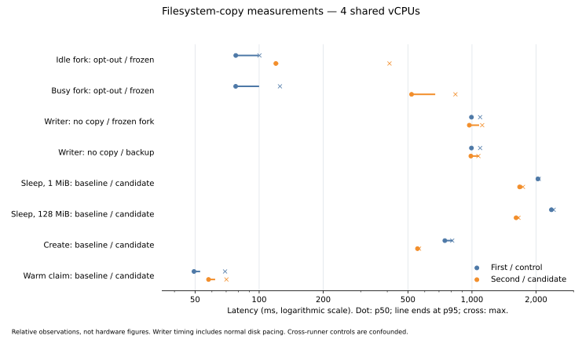

# ADR 0092: Filesystem-consistent copies: the guest freezes its filesystems around a disk snapshot, syncs before a memory one

Date: 2026-11-04 · Status: accepted (primitives and seal sync merged; slice C candidate measured; the one native RSS guard failure was allocator noise: #130 replaced that check with a trend over cycles); amends ADR 0031 (a snapshot's consistency is recorded), ADR 0008 and ADR 0023 (a backup of a running machine is filesystem-consistent by default), ADR 0005 (a suspend syncs the guest first), ADR 0076 (a seed is sealed after a sync); adds three ops to the guest protocol (ADR 0004)

## Context

Every disk copy briqyard makes is a ZFS snapshot of the machine's zvols taken while the guest runs on: a named snapshot (`machine/snapshots.rs`, `zfs.snapshot_all`), a backup (`backups/take.rs`, one `zfs snapshot` per disk, two instants), a fork (`create.rs::make_disks`, `fork-<id>`, the same). None asks the guest anything first. What the guest holds in its page cache and journal is not on the zvol yet, so the copy is what a power cut would leave. The docs say so (`docs/OPERATIONS.md`, the backup route in `api/openapi/00-routes.fragment.yaml`); the fork path does not even say that.

What it costs, observed:

- The stress driver's churn cycle (PR #121, run 41737007356) snapshots a machine just after boot, while python writes `__pycache__/*.pyc`. The machine restored from it logs `EXT4-fs (vda): recovery complete`, then `EOFError: marshal data too short`, then exit 1. ext4's journal replays and the files exist, but their bytes were never written: a torn file, and the app that depends on it dies. The driver works around it with an explicit `sync` after each write.
- A memory snapshot is consistent as a pair (ADR 0031: the pause stops the writers, the memory holds the cache, the zvols are flushed on the host): a *resume* from it is exact. Its disks alone, cloned by a fork or sent by a backup, are crash-consistent like any other.

Forks are the base of sandboxes and the restore of a backup is the last line of a customer's data. A torn file in either reads as silent data loss, whatever the docs promise. The Kubernetes reference model does the same thing at the same place: a CSI `VolumeSnapshot` of a mounted volume is crash-consistent unless the node agent runs `fsfreeze` around it, which is what every production snapshot controller does for a live volume. It is the host's job, not the workload's.

The guest has what it takes: `briqyard-init` is PID 1 and root in every machine (ADR 0004), a gateway's included; the app runs under it as the image's user. It serves a request channel over vsock, one connection per operation, with ops added without a wire break (ADR 0027; an init older than an op answers `unknown op`, which the daemon reads as `UnknownOp`). It already runs `sync()` before resetting the machine at a stop (`serve.rs::halt`). There is no guest without it.

## Decisions

**Two guest primitives, in the init: `fs_sync` and `fs_freeze` (held, then `fs_thaw`).**

- `fs_sync`: `syncfs(2)` on the root filesystem and on every writable mount of `cfg.mounts` (`Mount.read_only` mounts are skipped), answers `ok`. Writers are never blocked; what was dirty is on the zvol when the answer leaves. A write that lands after the answer can still be torn in a copy.
- `fs_freeze`: `FIFREEZE` on the same filesystems, last mounted first (the volume, then the root, as the usual guest agents do), answers `ok` with the list frozen, **and keeps the connection open**. The freeze lasts while the connection lives: the daemon's `fs_thaw` frame on it, the daemon closing it, or the connection dying with the daemon or with Firecracker's reset all thaw. A hard deadline thaws too: `timeout_ms` from the request, capped by the init at 30 s, 10 s when 0. The deadline starts only after all freeze ioctls succeed, so the flush does not consume the hold budget. The thaw answer says which ended it (`ok`, or `error` `freeze expired`), so the host never records as frozen a snapshot the guest had already thawed under. The host's close ending the operation is ADR 0029's rule for an exec; the guest's own deadline is what thaws a frozen guest when nothing on the host can.
- `FIFREEZE` flushes dirty data and the journal with writers already blocked, so a sync just before shortens the frozen interval to what arrived in between: the daemon always sends `fs_sync` first, then `fs_freeze`. Both run on dedicated threads, never on its two runtime threads, and the thaw uses the descriptors the freeze opened, so a frozen filesystem can never stall the thaw itself. The init writes nothing to a frozen filesystem on its own: its log is the serial console.
- A filesystem that refuses (`EBUSY`: the guest froze it itself; `EOPNOTSUPP`: not ext4, a guest remounted something else there; `ENOENT`: a configured path disappeared) is reported by name in an `error` answer after the others are thawed again. A configured mount whose device never mounted may still have its directory on root: freezing it succeeds, then freezing root returns `EBUSY`; rollback thaws the shared filesystem and reports that mounted devices should be checked. The daemon then takes the copy crash-consistent and says so. A guest can only make its own copies crash-consistent, the same as today, and nothing a guest does reaches the daemon past a bounded call: the daemon's freeze call has the control timeout (10 s, as `destination_control`), the ZFS command its own stall guard (ADR 0046), and both run under that machine's entry lock alone. Slice C must pass an explicit hold duration and classify any ZFS command that outlasts the capped guest deadline as `freeze_expired`; the storage stall guard observes a command, it does not cancel it. Dropping a timed-out control call closes its connection. A stuck guest worker can only stall that guest, never a daemon worker or another machine.
- `FITHAW` on a filesystem the guest thawed meanwhile (`EINVAL`) is success. A guest that freezes itself after our thaw hangs itself, as it can today.

**A disk-only snapshot, a backup and a fork of a running machine are taken frozen.** Order, under the machine's lock: `fs_sync` → `fs_freeze` → one `zfs snapshot` of both disks (`snapshot_all`; a backup and a fork take theirs at one instant from now on, as a named snapshot always has) → `fs_thaw`. The clone of a fork, the send of a backup and every record write happen after the thaw: the guest is frozen for one ZFS command and two vsock round trips, plus whatever the sync left for the freeze to flush.

**A memory snapshot and a suspend sync, never freeze.** The pause stops the writers and the memory holds the cache, so the pair needs nothing; what the sync buys is disks that stand on their own for a fork or a backup made from them. A freeze must never be in a memory image: a clone or a warm slot resumed from it would wake frozen, with nobody to thaw it. In slice C the daemon sends `fs_sync`, then pauses. The suspend sync in `shutdown.rs::stop_entry` must use the control timeout (10 s), then suspend anyway on timeout or error with `suspend_synced = false` and an `fs_sync` profile stage. Every idle sleep passes through this path and remains metered until it lands; a slow sync must never prevent sleep. This daemon use is deferred to C and does not change the init digest. Writes between the sync's answer and the pause can tear in a disk-only copy; the memory has them.

**A template seal (a seed, a warm template) is taken after a sync.** The builder is the init holding at its barrier before any workload (`init-ready-v1`, `sandbox-ready-v1`), so the sync drains the init's own writes and nothing follows: the sealed root disk is clean, and a restore of the artifact starts from a filesystem that needs no recovery. The seal sends `fs_sync` before the pause. **It fails closed**: `UnknownOp`, any error or a control timeout aborts the seal before any memory snapshot; an unsynced seed would contaminate every clone of its generation. The fallback rule for copies does not apply to seals.

The barrier permits sync without activation: `init/clone.rs::Gate::allows` and `init/destination.rs::Barrier::allows` admit `fs_sync`; `init/mod.rs` starts the listener while waiting for activation. `init/serve.rs::handle` dispatches to `init/filesystems.rs::serve`. Sync uses a dedicated thread joined before the answer, avoiding Tokio's roughly 10-second idle `spawn_blocking` thread retention. `guestc.rs::sync_answer` reads the answer **and EOF**, within the control timeout, before `templates/sealing.rs::check_template_seal` returns to `snapshots.rs::snapshot_with_memory` for the pause. EOF follows stream destruction as the handler returns; no sync worker or half-finished handler remains in the image. Native `hack/e2e-seals.sh` seals both sandbox disk shapes, creates from each seed and checks the first command.

Volume-free machines are normal: only root and configured writable mounts are opened; `/work` is never assumed. An unmounted pristine sandbox data device has no guest filesystem to flush. Read-only configured mounts are skipped before opening them, and `fstatvfs` also skips actual read-only filesystems. **This changes every seed's identity**: a recipe is identified by its init digest (ADR 0091) and the init gains three ops, and the sealed bytes change. Every seed is sealed again and goes into the one re-qualification of the release this ships in.

**Where a copy's source is not running.** A stopped state alone is not proof of a clean filesystem. A recent non-OOM init exit report, without host-forced termination, records `filesystem`; an OOM records `crash`/`oom_killed`, an unreported VMM exit `crash`/`unclean_exit`, a host kill `crash`/`forced_stop`, and missing or stale stop evidence `crash`/`unverified_stop`. The init reports before its halt sync, so a recorded host kill overrides a racing report. A created machine that has never booted is `filesystem` only for a fresh image; source copies inherit their fork consistency or remain `crash` without evidence. Restoring disks invalidates the previous stop evidence. A suspended machine's disks are `synced` once the suspend above ran; a machine suspended by an older daemon, or whose init did not know `fs_sync`, is `crash`, and the record says which (`suspend_synced`). An error state without clean exit evidence is conservative `crash` too.

**The result says what it got.** `consistency: filesystem | synced | crash` on `Snapshot` and `Backup`, on the forked machine (`fork: {machine_id, consistency}` in its record and view) and in the data of `snapshot_taken`, `backed_up` and the fork's `created` event. `filesystem` only when the freeze held through the ZFS command and the thaw confirmed it; `synced` when the guest flushed just before (a memory snapshot, a suspended source); `crash` otherwise, with `consistency_reason` naming why: `init_too_old` (`UnknownOp`), `freeze_refused` (the guest's `error`, with the filesystem), `freeze_timeout` (the freeze control timeout), `sync_timeout` and `sync_refused` (sync failed without a freeze attempt), `freeze_expired` (the guest's deadline fired first), `unsynced_suspend` (a suspended source without `suspend_synced`). For a snapshot, backup or fork, a fallback never fails the operation (a seal fails closed): the backup is sent, the snapshot kept, the fork made, and the event is a `warning` instead of `normal`. On `/metrics`: `briqyard_copies_total{operation, consistency}` and `briqyard_fs_freeze_seconds` (a histogram of the host-observed hold from the freeze acknowledgment through the thaw acknowledgment), so an operator sees a fleet drifting to `crash` or a workload that stalls on every backup.

**Opt-out, per request, never a default.** `consistency: "crash"` on `SnapshotRequest`, on `ForkSpec` and on the backup request body skips the guest calls for a caller that knows its workload does its own consistency or needs the fork a round trip sooner. The scheduled backup policy has no such field: a schedule is for the data's sake.

**Create and warm-claim paths are untouched.** A create from an image clones `images/<key>@base`: no guest exists. A claim from a ready slot or a strict named-memory fork restores a sealed artifact: no guest call, no snapshot. Only a snapshot, a backup, a disk fork and a seal pay, and a seal pays once per generation.

**Measured cost.** The shared-host experiment and its limitations are below. A full fork
includes sync, freeze acquisition, storage, thaw and clone work; profile stages identify
those costs. N forks currently imply N freezes; the backlog's N-way batched fork should
freeze once for its batch. This PR does not implement that batch path.

Rejected, one line each:

- `sync` alone everywhere: cheap, but a write between the sync and the snapshot is still torn; the stress flake is exactly a writer that never stops. `sync` is kept where a freeze cannot be (memory).
- A freeze before a memory snapshot or a suspend: consistent to the byte, but the frozen state is saved in the memory image and resumes frozen.
- The daemon thawing by a second connection only: a daemon that died mid-copy leaves the guest frozen until its deadline; the held connection thaws it at once.
- A lease the daemon renews: more protocol for the same bound; the deadline is the lease.
- `fsfreeze` by `exec` in the guest: needs the image to ship `util-linux`, and runs as the image's user; the init is root on every image.
- Failing the backup when the freeze fails: a crash-consistent backup is worth more than none, and the result says what it is.
- Quiescing the workload (a `SIGSTOP`, a hook): application consistency is the app's (Postgres is fine with a frozen filesystem; it is what its own base backups assume), and a hook is a feature ahead of a need.

## Consequences

- Once slice C lands, a copy of a running machine holds what the guest wrote, and a restored machine boots without `recovery complete`. The docs' "stop the machine first for a clean one" goes; what stays is that an application with its own write-ahead log is consistent on its own terms.
- A backup now stalls the guest's writers for the ZFS command once per `every`; a fork, once. A workload that cannot bear it opts out per request; a fleet-wide problem shows on `briqyard_fs_freeze_seconds`.
- The init changes: every root disk is made again with it (the init is in the image key, ADR 0037), every seed and warm template is sealed again, one re-qualification. Until a machine's root disk is remade its copies say `crash` with `init_too_old`; the control plane reads the field, never the version.
- A backup's `consistency` is in its record in the store, so a restore anywhere can show it.
- Machine-level consistency (two machines' disks at one instant) is not built; a stack is the control plane's concept.
- Reopen when a memory-image resume can run a hook in the guest: a freeze before the pause would then be thawed on resume, and memory snapshots could say `filesystem` too.

Slice A and the seal sync are merged. Slice C integrates snapshots, backups, disk forks and bounded suspend sync, consistency records, request opt-out and metrics; measurements and native evidence are recorded below, with one RSS guard failure, since read as allocator noise (#130 replaced the check). Every root disk, seed and warm template must be rebuilt for the changed init digest, before the next release; the runtime owner sequences it.

Legacy `put` writes run on the blocking pool: two writers blocked by a freeze must not occupy both async runtime threads and prevent host thaw. This does not affect barrier sync, since the barrier rejects `put`. The daemon reads a buffered deadline terminal even if sending thaw encounters a closed peer, and reports `FreezeExpired`.

## Slice C measured cost and qualification

[Completed experiment](https://github.com/briq-cloud/briqyard/actions/runs/41763170099),
[raw samples](../research/2026-11-04-fsfreeze-cost.json). Baseline
`fca50022bf3888887827f078035610f277197987`; candidate measurement harness
`3897a05a77c6e77f9e3f3e9379f05b8f4081de9c`; runtime code
`09810db56894eac01965117570988497b7cf71dc` (only test scripts changed afterward).
Both runners reported x86_64 and **4 shared vCPUs**. These are relative figures,
not hardware figures or a causal performance comparison between hosts.

Method: `hack/measure-freeze.sh`, native workflow input `measure_freeze=true`.
Each job builds its source, installs an isolated host, and restores its test configuration
on exit. Root-only Python 3.12 Alpine guests have 1 vCPU and 512 MiB RAM. Image create
controls use the already-cached image. These are repeated samples on one source per runner, not twenty independent hosts.
Twenty alternating crash/default fork pairs are
measured idle and busy, ending at `created`, before clone deletion. All 40 candidate
default copies reported `filesystem`, and all 40 opt-outs reported `crash`.
The busy writer rewrites 32 MiB of incompressible data and fsyncs, continuously,
at a 32 MiB/s disk limit, no IOPS limit and no burst. Twenty no-copy writes establish
writer readiness and its control. Writer samples are full write+fsync durations completing
in the copy/cleanup window: ordinary disk pacing is included; they do not isolate kernel
freeze time. The short opted-out windows contained no completed candidate writer samples,
so the no-copy writer control is used rather than inventing a zero-sample percentile.
Backup samples run while the writer continues. p50 is the median, p95 the nearest rank
`ceil(0.95*n)`, max the largest observation; units below are milliseconds.

| Operation / observed I/O duration | n | p50 ms | p95 ms | max ms |
|---|---:|---:|---:|---:|
| Idle fork, crash opt-out | 20 | 77.7 | 98.7 | 100.3 |
| Idle fork, frozen | 20 | 119.8 | 122.0 | 409.6 |
| Idle fork added, paired | 20 | 42.0 | 44.1 | 330.6 |
| Busy fork, crash opt-out | 20 | 77.6 | 99.1 | 125.2 |
| Busy fork, frozen | 20 | 520.2 | 666.2 | 835.9 |
| Busy fork added, paired | 20 | 442.7 | 588.6 | 710.7 |
| Writer, no copy control | 20 | 994.3 | 1007.3 | 1092.0 |
| Writer during frozen forks | 20 | 971.4 | 1071.3 | 1116.8 |
| Writer during backups | 25 | 988.0 | 1068.9 | 1072.0 |
| Backup, idle source | 20 | 119.9 | 124.5 | 164.2 |
| Backup, busy source | 20 | 1068.1 | 2038.2 | 2038.3 |

Idle sleep is request-to-`stopped`, after writing 1 or 128 MiB without a sync,
then resuming for the next of twenty samples. These are write sizes, not a measurement
of dirty pages remaining at the stop. Warm claim uses a qualified pinned Alpine
`init-ready-v1` artifact and one ready slot: twenty API claims through host readiness.
Sealing, refill waits and deletion are outside the timed claim interval. Create ends
at `running`, before deletion. Baseline and candidate use separate shared runners.

| Control / lifecycle | baseline p50 / p95 ms | candidate p50 / p95 ms | difference of p50 / p95 ms |
|---|---:|---:|---:|
| Sleep after 1 MiB write (n=20 each) | 2041.3 / 2053.2 | 1674.1 / 1713.7 | -367.2 / -339.5 |
| Sleep after 128 MiB write (n=20 each) | 2361.6 / 2399.2 | 1611.7 / 1652.1 | -749.9 / -747.1 |
| Create control (n=20 each) | 745.6 / 804.4 | 554.7 / 563.6 | -190.9 / -240.8 |
| Warm-claim control (n=20 each) | 49.4 / 52.4 | 57.8 / 61.6 | +8.4 / +9.2 |

The negative sleep deltas are not evidence that sync speeds up sleep. The unchanged
create path also shifted substantially, while warm claim moved the other way.
Shared-runner/cache variation confounds cross-host differences. Code tracing, independently
of these noisy controls, confirms no new sync/freeze on create or warm claim. Writer
latencies overlap their paced no-copy control; these samples do not isolate an extra
freeze-only stall. The freeze histogram is host-observed through thaw acknowledgment,
including transport; no init timing field was added.

### Native evidence

Eight parallel native dispatches on the runtime head: **7 stress passes, 1 stress failure**.
All eight logged 376/376 checks, but the driver exit remains authoritative. The failure
had zero API failures and one invariant break:

> after churn: daemon RSS grew 34.2 MB over cycles 3..4 (bound 32 MB)

[Failed run](https://github.com/briq-cloud/briqyard/actions/runs/41761124915).
There was no guest console dump and no marshal error in that job. This remains a stress
failure; the RSS cause is unresolved and the bound was not weakened. It is not full green
qualification. Eight observations would not establish zero recurrence even with eight passes.

| Manual run | Stress driver | E2E | Fleet smoke | Monitoring | Two hosts | Restore |
|---|---|---:|---:|---:|---:|---:|
| [41761103063](https://github.com/briq-cloud/briqyard/actions/runs/41761103063) | success (376/376 logged) | 294/294 | 33/33 | 18/18 | 29/29 | 10/10 |
| [41761106971](https://github.com/briq-cloud/briqyard/actions/runs/41761106971) | success (376/376 logged) | 294/294 | 33/33 | 18/18 | 29/29 | 10/10 |
| [41761110730](https://github.com/briq-cloud/briqyard/actions/runs/41761110730) | success (376/376 logged) | 294/294 | 33/33 | 18/18 | 29/29 | 10/10 |
| [41761113712](https://github.com/briq-cloud/briqyard/actions/runs/41761113712) | success (376/376 logged) | 294/294 | 33/33 | 18/18 | 29/29 | 10/10 |
| [41761117357](https://github.com/briq-cloud/briqyard/actions/runs/41761117357) | success (376/376 logged) | 294/294 | 33/33 | 18/18 | 29/29 | 10/10 |
| [41761120887](https://github.com/briq-cloud/briqyard/actions/runs/41761120887) | success (376/376 logged) | 294/294 | 33/33 | 18/18 | 29/29 | 10/10 |
| [41761124915](https://github.com/briq-cloud/briqyard/actions/runs/41761124915) | failure (376/376 logged) | 294/294 | 33/33 | 18/18 | 29/29 | 10/10 |
| [41761128832](https://github.com/briq-cloud/briqyard/actions/runs/41761128832) | success (376/376 logged) | 294/294 | 33/33 | 18/18 | 29/29 | 10/10 |

[Normal PR native run](https://github.com/briq-cloud/briqyard/actions/runs/41762969119)
completed successfully with the same six suite counts. Its stricter detector observed a
missing file in the explicit crash-opted-out disk fork **148 ms** after beginning the write;
transport/exec failures cannot count as missing data. The frozen snapshot and fork retained
27 bytes within the one-second bound. A longer trial fails as inconclusive.

Two superseded PR workflows were partial/cancelled: [41761046448](https://github.com/briq-cloud/briqyard/actions/runs/41761046448)
completed stress successfully but failed second-host setup before suite counts, and
[41762295989](https://github.com/briq-cloud/briqyard/actions/runs/41762295989) cancelled stress
before completion. Including those attempts: nine stress successes, one RSS failure,
one cancelled attempt at the time of this documentation. Any subsequent documentation-only
CI results are recorded in the PR; no completed failure is dropped from the report.

Review corrections also check memory eligibility before sync, use sync-named failure
reasons, reject malformed optional request bodies, and classify stopped copies from
current exit evidence. Host kills override racing pre-sync init reports; stale evidence
is invalidated by restore. The freeze sequence, locks, atomic snapshot and create/warm
paths are unchanged. Slice A and seal sync are merged; slice C remains an unmerged candidate.
No additional init change or second init qualification is introduced by slice C.
